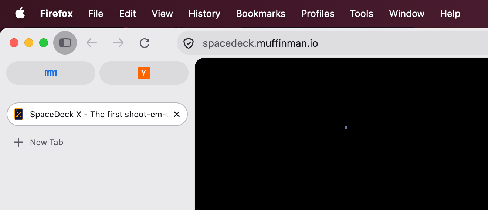
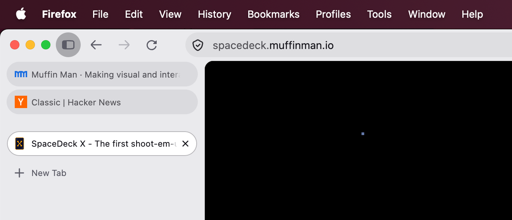

+++
title = "Stacked Pinned Tabs in Firefox"

category = ["Random"]
tags = ["firefox", "tabs"]

image = "./img/vertical.png"
intro = "I love vertical tabs, but I couldn't find a way to stack Firefox's pinned tabs vertically and show their titles. After some trial and error, I styled them the way I wanted using some custom CSS."
+++

I love vertical tabs. I used Tree Style Tab for years, then switched to Sidebery and recently to Firefox's native vertical tabs. I like them, but I was annoyed by the pinned tabs appearance. By default they are collapsed with only their favicon visible:



Luckily, there is a way to change that by adding some custom CSS. After applyin it, my tabs looked like this:



## CSS

I couldn't find an existing snippet anywhere, and it took me some trial and error to get it right. Here is the CSS code, I hope you find it useful:

```css
/* Show title */
#pinned-tabs-container[orient='vertical'] .tab-label-container {
  display: flex !important;
  margin-right: 1.5rem;
}

/* Change tabs layout to be stacked under each other */
#pinned-tabs-container[orient='vertical'] {
  --pinned-slot-display: block;
}

slot[part~='items-wrapper'] {
  display: var(--pinned-slot-display, flex) !important;
}

/* Remove extra vertical padding */
#pinned-tabs-container > .tabbrowser-tab {
  padding-block: 0 !important;
}

/* Move the green status dot to the right */
#pinned-tabs-container .tab-content:is([titlechanged], [attention]) {
  background-position: right 1.25rem center !important;
}

/* Make space for the green status dot */
#pinned-tabs-container .tab-icon-stack {
  margin-inline: 0.5rem;
}
```

## How to use userChrome.css

To customize Firefox's UI via CSS, you'll need the following:

- In Firefox, open the `about:support` page and open your profile's Root Directory in your file manager.
- Inside your profile folder, create a folder named chrome.
- Inside it, create `userChrome.css`.
- Add your custom CSS to it.
- Open `about:config`, find `toolkit.legacyUserProfileCustomizations.stylesheets` and set it to `true`.
- Restart Firefox.

If you need more details, there is [a great website](https://www.userchrome.org/) that explains it in detail.
